<p align="center">
  <picture>
    <source media="(prefers-color-scheme: dark)" srcset="https://raw.githubusercontent.com/k-pulkit/cognitune/main/assets/banner-dark.svg">
    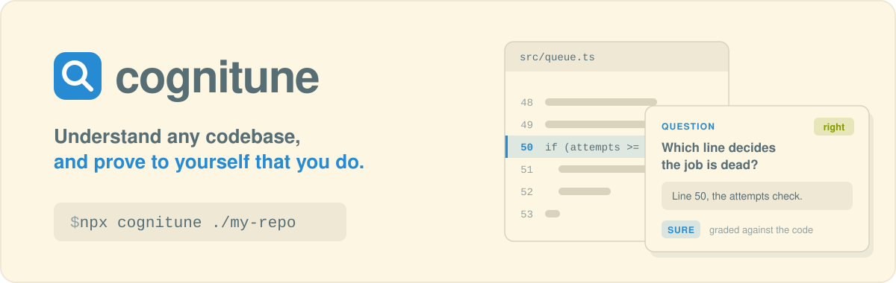
  </picture>
</p>

<p align="center">
  <a href="https://www.npmjs.com/package/cognitune"></a>
  
  
  
</p>

<p align="center">
  <a href="#try-it-in-a-minute"><b>Try it</b></a> ·
  <a href="#what-you-do-in-it"><b>What you do in it</b></a> ·
  <a href="#why-it-works"><b>Why it works</b></a> ·
  <a href="SETUP.md"><b>Setup</b></a> ·
  <a href="CHANGELOG.md"><b>Changelog</b></a>
</p>

AI makes code faster to write and easier to not understand.
**cognitune turns the model around: it does not write code for you. It teaches you the code you have, then checks that you got it.**

## Try it in a minute

```bash
npx cognitune --demo        # a sample repo with canned answers. No model, no login.
npx cognitune ./my-repo     # your own code, with the coding CLI you already use
```

- **No new account, no key.** It runs Claude Code, Codex or Copilot with that CLI's own login.
- **Read-only.** It works from the files you tick, and cognitune never writes to your folders.
- **Local.** A web app on `127.0.0.1`. Your notes and scores are plain JSON files in `~/.cognitune`.

<p align="center">
  <picture>
    <source media="(prefers-color-scheme: dark)" srcset="https://raw.githubusercontent.com/k-pulkit/cognitune/main/assets/screenshots/lens-dark.png">
    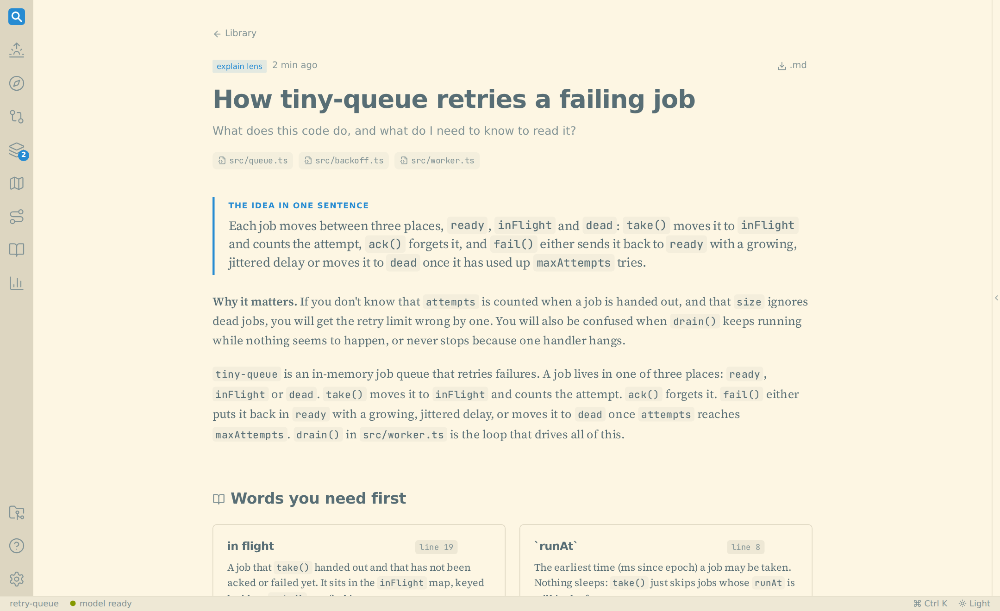
  </picture>
  <br>
  <sub>A lens: one question, answered about the files you picked. The screenshots are real model output on the bundled 100-line demo repo (Map and Progress show cognitune's own source).</sub>
</p>

## What you do in it

<p align="center">
  <picture>
    <source media="(prefers-color-scheme: dark)" srcset="https://raw.githubusercontent.com/k-pulkit/cognitune/main/assets/loop-dark.svg">
    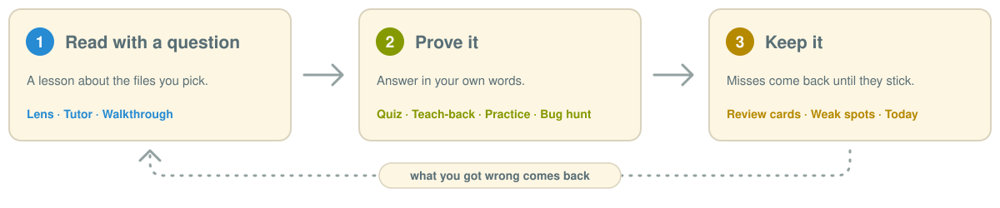
  </picture>
</p>

### 1. Read with a question

| | |
|---|---|
| **Lens** | Pick files, pick a question: *Explain*, *Data flow*, *Failure modes*, *Trace a run*, *History*, or your own. You get a lesson where every step shows its own lines of code. Ask a follow-up and the answer joins the same lens. |
| **Tutor** | A Socratic chat. It gives a nudge first, then a hint, then more. Say "just tell me" any time. Click "line 50" in a reply and the code pane jumps there. |
| **Walkthrough** | The file in reading order, one block at a time. Each block ends with a question you answer before you go on. |

<p align="center">
  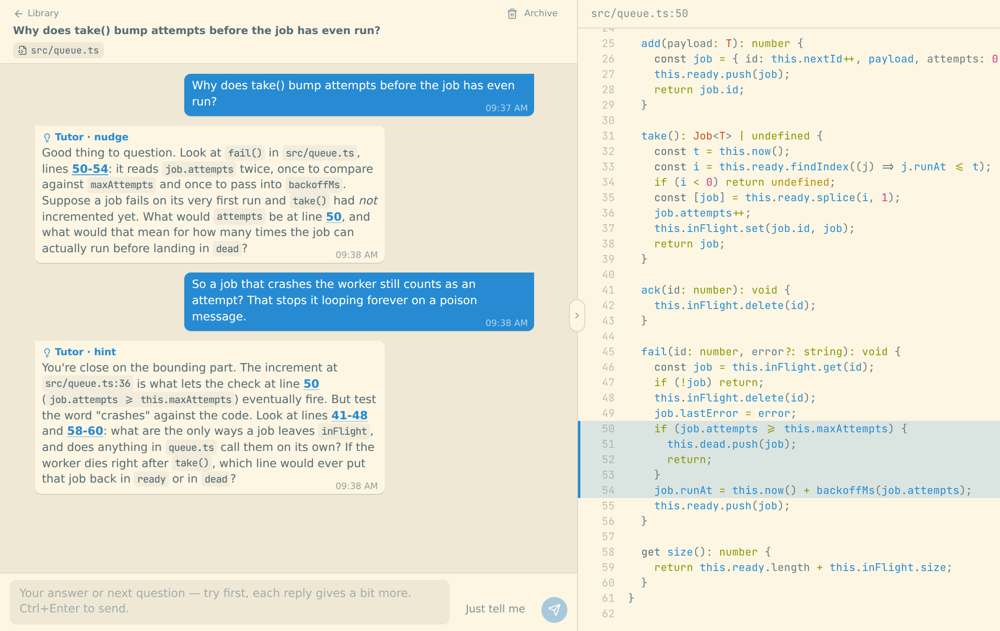
  <br>
  <sub><b>Tutor.</b> A nudge, then a hint. The blue line numbers jump the code pane.</sub>
</p>

<table>
  <tr>
    <td width="50%"></td>
    <td width="50%"></td>
  </tr>
  <tr>
    <td align="center"><sub><b>Follow-up.</b> Ask more; the answer is added to the lens.</sub></td>
    <td align="center"><sub><b>Walkthrough.</b> Answer the check, then the next block.</sub></td>
  </tr>
</table>

### 2. Prove it

| | |
|---|---|
| **Quiz** | Free-text questions about behaviour and reasons, not names. Mark each answer *sure* or *guess*. The feedback names the line you got wrong. A wrong answer you were sure of is flagged first. |
| **Teach-back** | Explain the code in your own words. Graded 1-5: what is right, what is missing, what is wrong. |
| **Practice** | The key logic is cut out of a copy of your file. Write it back, with hints. |
| **Bug hunt** | Bugs are planted in a copy of the file. Find them and say why. |
| **Changes** | A split diff of two git refs, or of your uncommitted work. Every activity above can run on the diff. Good before you merge code you did not write. |

<p align="center">
  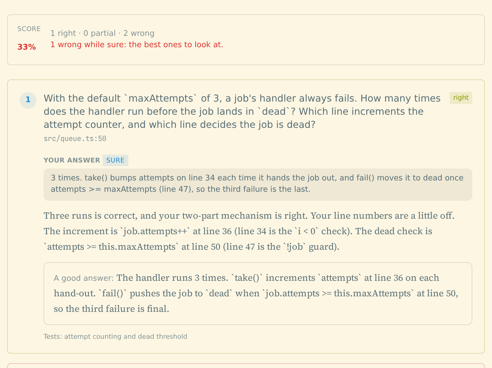
  <br>
  <sub><b>Quiz.</b> The answer was right, the line numbers were off, and the feedback says so.</sub>
</p>

<table>
  <tr>
    <td width="50%">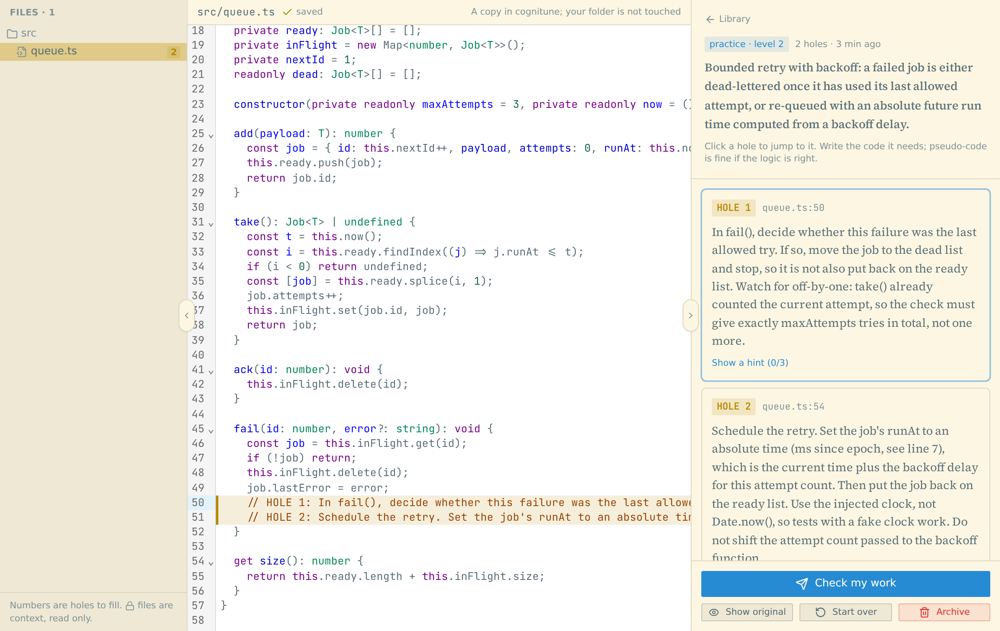</td>
    <td width="50%">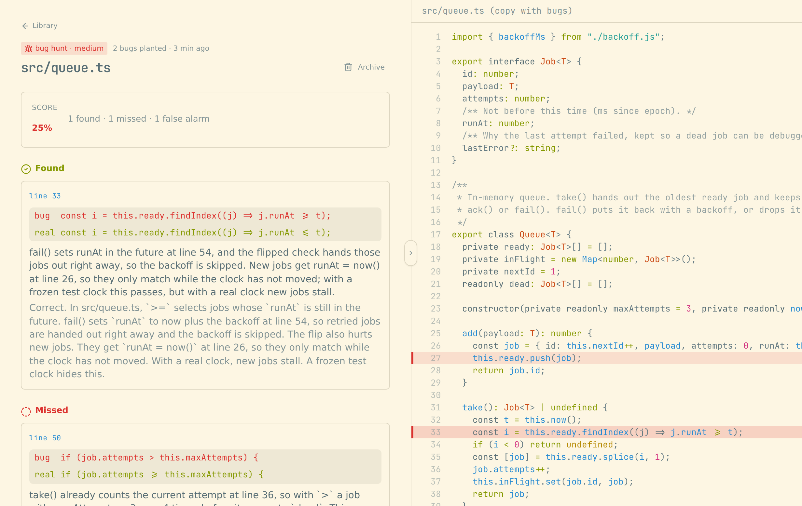</td>
  </tr>
  <tr>
    <td align="center"><sub><b>Practice.</b> Write the missing logic back, then check your work.</sub></td>
    <td align="center"><sub><b>Bug hunt.</b> Found, missed and false alarms, each explained.</sub></td>
  </tr>
</table>

<p align="center">
  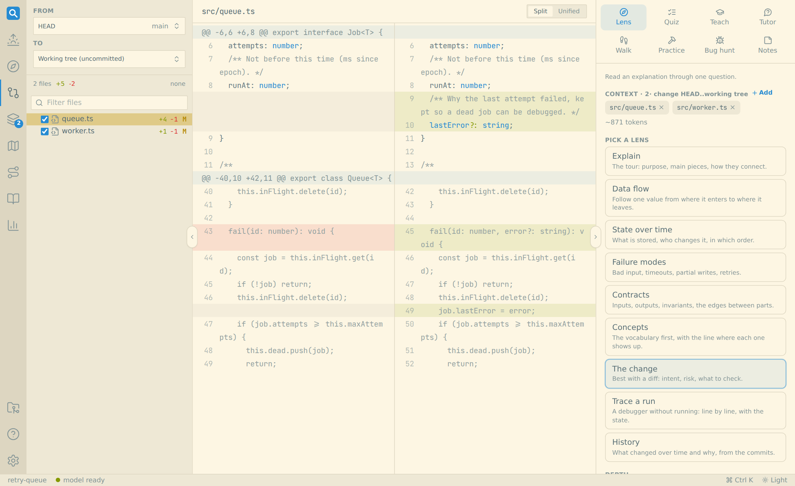
  <br>
  <sub><b>Changes.</b> Read the diff, then lens it, quiz yourself on it or ask the tutor about it.</sub>
</p>

### 3. Keep it

| | |
|---|---|
| **Weak spots** | A wrong answer is saved as the belief behind it: "you think X, but Y". The next quiz aims at exactly those. A right answer clears one. |
| **Review cards** | Quiz misses become spaced-repetition cards (FSRS). Each card links back to the quiz or lens it came from. |
| **Today** | Each project opens on what to do now: cards due, weak spots, files that changed, the next stop on your path. |
| **Map, Paths, Progress** | See how the repo hangs together, take an ordered tour of it, and see what you have proved and what is fading. |

<table>
  <tr>
    <td width="50%">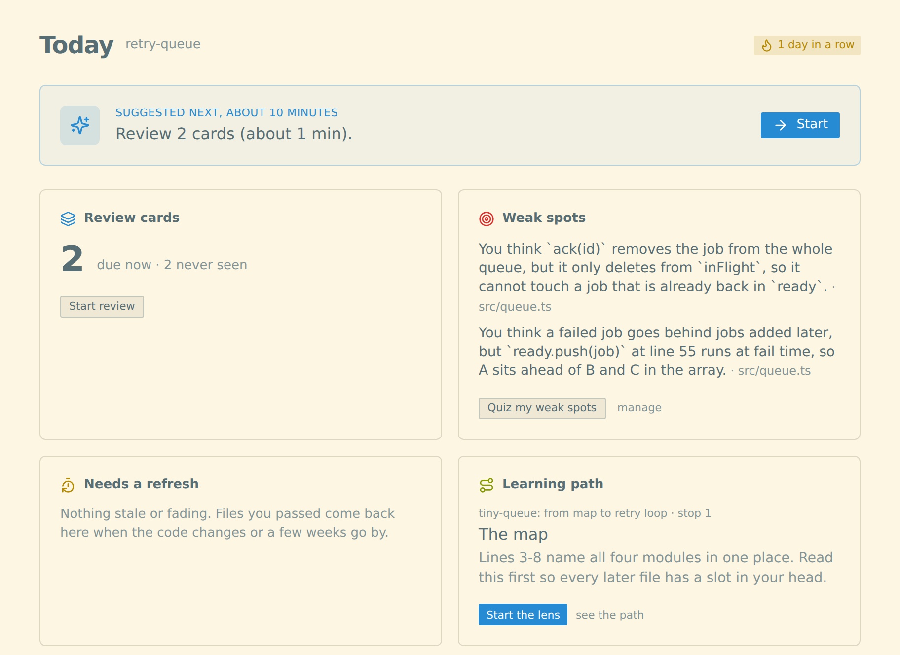</td>
    <td width="50%"></td>
  </tr>
  <tr>
    <td align="center"><sub><b>Today.</b> What to do now, in about 10 minutes.</sub></td>
    <td align="center"><sub><b>Review.</b> Recall first, then reveal and rate.</sub></td>
  </tr>
  <tr>
    <td width="50%">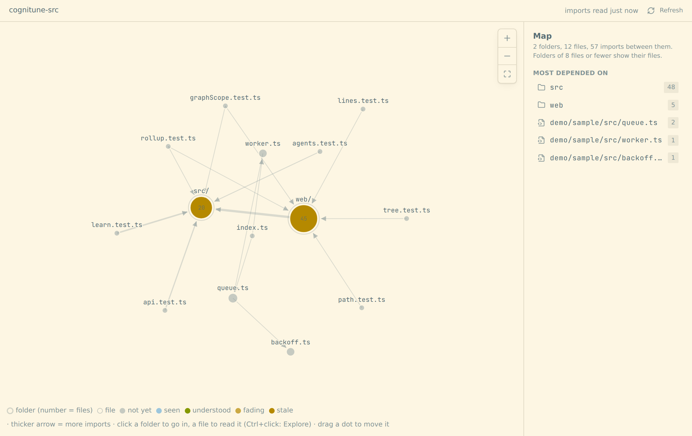</td>
    <td width="50%">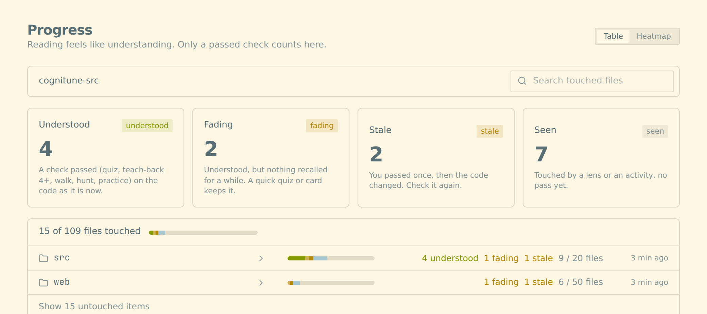</td>
  </tr>
  <tr>
    <td align="center"><sub><b>Map.</b> Repos and folders, then files. Click a folder to go in.</sub></td>
    <td align="center"><sub><b>Progress.</b> Per repo, folder and file: proved, fading or stale.</sub></td>
  </tr>
</table>

## Use it when

- You joined a team and must find your way in a repo you did not write.
- An agent wrote the code and you must own it. Open **Changes** and quiz yourself on the diff.
- You come back to your own code after six months.
- You review a pull request and want to know what it does, not only that it looks fine.

## Why it works

Three findings from learning research decide how every page behaves.

| The finding | What cognitune does about it |
|---|---|
| **Recall beats re-reading** | Quizzes and teach-back are free text. You write the answer; you do not pick it from a list. |
| **Spacing beats cramming** | Misses come back as review cards on a schedule. Progress marks a file *fading* when you stop recalling it. |
| **Answer first, then read** | The tutor hints before it tells. A lens can ask for your own take first. A missed check asks you to try again. |

## Reference

<details>
<summary><b>All features</b></summary>
<br>

| | |
|---|---|
| **Lenses** | See code through one question: *Explain*, *Data flow*, *State over time*, *Failure modes*, *Contracts*, *Concepts*, *The change*, *Trace a run* (a debugger without running: line by line with the variables), *History* (why it is like this, from git), or your own. Tick **My take first** to write your own guess before the lens; it opens with where you differ. On a diff, that becomes **Predict first**. Ask follow-ups at the end; the answers are added to the same lens. A lens shows a banner when its code changes, with one-click refresh. |
| **Walkthrough** | The file in reading order (not file order), one block at a time, with a check question on each block before the next. Retry a block you missed. |
| **Tutor** | A Socratic chat over the files. It answers with a question or a hint first and gives a bit more each turn; ask it to just tell you any time. Line references jump the code pane. |
| **Map** | The import graph (TS/JS with tsconfig aliases, Python) at one scope: repos, then folders, then files. Thicker arrows carry more imports; click a folder to go in. A folder of 8 code files or fewer shows its files. |
| **Paths** | An ordered tour of the repo, 6-12 stops, each with the activity that fits. Stops tick off as you do them. |
| **Quizzes** | Free-text questions about behaviour and reasons, not names. Mark each answer *sure* or *guess*. Graded with feedback that names the line and a good answer to compare with. |
| **Teach-back** | Explain the code in your own words. Graded 1-5: what you got right, what you missed, what is wrong. |
| **Practice** | The key logic is cut out of a copy of your file (4 levels). Write it back, with hints, then "check my work". |
| **Bug hunt** | Realistic bugs are planted in a copy of the file. Click the lines you suspect and say why; see found, missed and false alarms. |
| **Changes** | Two git refs, or HEAD vs your working tree. Read the diff, then predict, lens, quiz, teach back or ask the tutor about the change itself. |
| **Review cards** | Spaced repetition (FSRS). Quiz misses become cards on their own; lens concepts and code lines can become cards in one click. |
| **Weak spots** | Wrong answers are saved as the belief behind them. Quiz one weak spot or all of them; a right answer clears one; dismiss one the grader got wrong. |
| **Today** | Due cards, weak spots, files that need a refresh, the next stop on your path, and one suggested 10-minute activity. |
| **Progress** | Rolled up per repo and folder, then per file: *seen*, *understood* (a check passed on the code as it is now), *fading* (no recall for a few weeks), *stale* (the code changed since). Pick a repo, drill into folders, search; table or heatmap. |
| **Library** | Everything made, searchable, plus a glossary and your margin notes. Export a lens or quiz as markdown, or a whole project as JSON. |

Context is what you pick: tick files in the tree, or add extra folders (docs, notes, design files) to a
project as context. The model works from what you give it. Long jobs keep running if you leave the page;
the status bar says when they are ready. <kbd>Ctrl</kbd>/<kbd>Cmd</kbd>+<kbd>K</kbd> jumps anywhere; <kbd>?</kbd> lists shortcuts.

</details>

<details>
<summary><b>Model access</b>: Claude Code, Codex, Copilot or the Anthropic API</summary>
<br>

cognitune makes one model call per lens, quiz, grade, practice, tutor turn and so on (about 15 s to 2 min).
Replies are checked against a schema (one retry with the problems listed), and lens, walkthrough and path
replies are cached: the same lens on an unchanged file is free the second time.
It drives a coding CLI you already use, with that CLI's own login, so **cognitune never asks for or
stores a key**. Pick one in Settings; *Auto* takes the first one it finds, in this order:

| Provider | How cognitune runs it | Login |
|---|---|---|
| **Claude Code** (default) | `claude -p`, read-only tools (`Read`, `Grep`, `Glob`) | your Claude Code login |
| **OpenAI Codex** | `codex exec -`, `--sandbox read-only` | `codex login` |
| **GitHub Copilot** | `copilot -p -s`, only the `read` tool (shell and write denied) | your Copilot login, or `COPILOT_GITHUB_TOKEN` / `GH_TOKEN` |
| **Anthropic API** | Messages API; the picked files go in the prompt | `ANTHROPIC_API_KEY` in the environment |

Each CLI runs with the project folder as its working directory. Model per provider is optional
(empty = the CLI's default). `COGNITUNE_AGENT=fake` gives canned answers, to try the UI without a model.

Step-by-step setup: [SETUP.md](SETUP.md).

</details>

<details>
<summary><b>Your files are safe</b>: local only, read-only, bounded storage</summary>
<br>

- cognitune never writes to your folders. Practice works on a copy.
- The server binds to `127.0.0.1` only. There is no login: it is a local, one-person tool.
- Everything it makes lives in `~/.cognitune` (change with `COGNITUNE_HOME`), as plain JSON files, one
  per item. Files, not SQLite: the data is small, you can read and back it up, and there is no native
  module to build.

```
~/.cognitune/
  settings.json  projects.json  jobs.json  prune.json
  projects/<id>/<lenses|quizzes|practice|cards|misconceptions|teachbacks|threads|walks|hunts|paths|notes>/<id>.json
  projects/<id>/archive/...        "Archive" moves items here
  archive/projects/<id>/           a project you removed from the list
  cache/<hash>.json                saved model replies
```

**It does not keep growing.** Every part that could grow has a limit (Settings > Storage shows the
sizes and has *Clean up now*):

| What | Limit (setting) |
|---|---|
| Archived items and removed projects | deleted after 30 days (`storage.archiveDays`; reopen a removed folder in time and its history comes back) |
| Model reply cache | 50 MB, least recently used goes first (`storage.cacheMB`) |
| Graded attempts per quiz | newest 20, the best one always kept (`storage.maxAttempts`) |
| Card review history, tutor messages, job history | 50 per card, 200 per chat, 100 jobs |
| Temp files left by a crash | removed after an hour |

Cleanup runs at start-up and every 6 hours, and only ever inside the cognitune folder.

</details>

<details>
<summary><b>CLI and development</b></summary>
<br>

```
cognitune [folder] [--port 4711] [--host 127.0.0.1] [--no-open] [--demo]
```

```bash
npm install
npm run dev          # API on :4711 (tsx watch) + Vite on :5173 with hot reload
npm test             # core and API tests (vitest, fake model, temp git repos)
npm run typecheck
npm run build        # dist/web (Vite) + dist/cli.js (tsup)

# Browser smoke test over every page (needs a Chromium; set CHROME or have one in ~/.cache/ms-playwright)
COGNITUNE_HOME=$(mktemp -d) COGNITUNE_AGENT=fake node dist/cli.js . --port 4799 --no-open &
node test/ui-smoke.mjs [--dark] [--shots DIR]
```

Layout:

```
src/cli.ts              CLI: serves the API and the built web app
src/server/app.ts       Hono routes under /api
src/core/               no HTTP here: workspace (files, git), graph (imports), store, storage (limits, cache),
                        prompts, schemas, services (model work), insights (cards, progress, today), jobs, agent adapters
demo/sample/            the small repo --demo opens
web/src/                React + Vite + Tailwind: pages/, components/, lib/
```

Stack: TypeScript everywhere. Hono on Node 20+, zod, ts-fsrs. React 18, React Router, TanStack Query,
Tailwind, Shiki (code), CodeMirror (practice editor), Mermaid (diagrams), d3-force (map).

</details>

## License

MIT

<p align="center"><sub>If cognitune helped you understand something, <a href="https://github.com/k-pulkit/cognitune/issues">tell me what you would change</a>.</sub></p>
