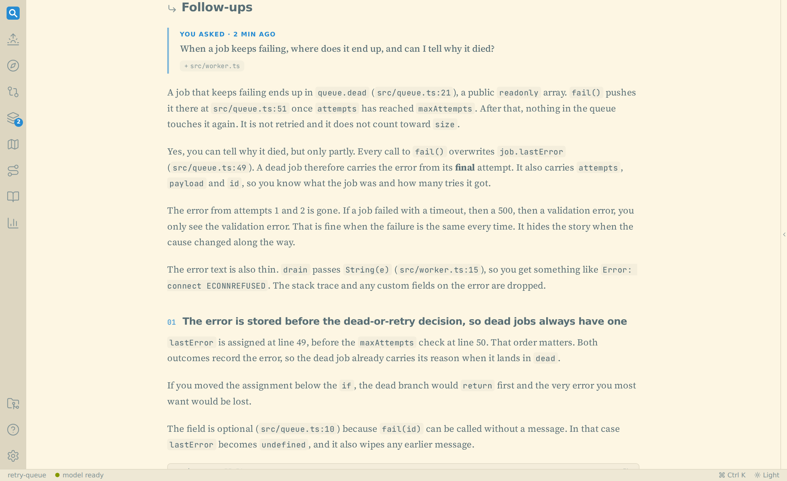
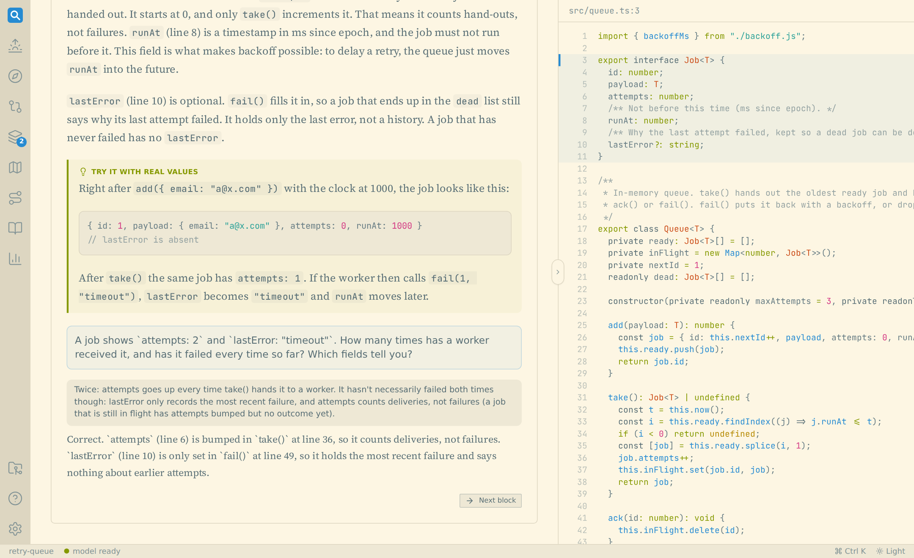
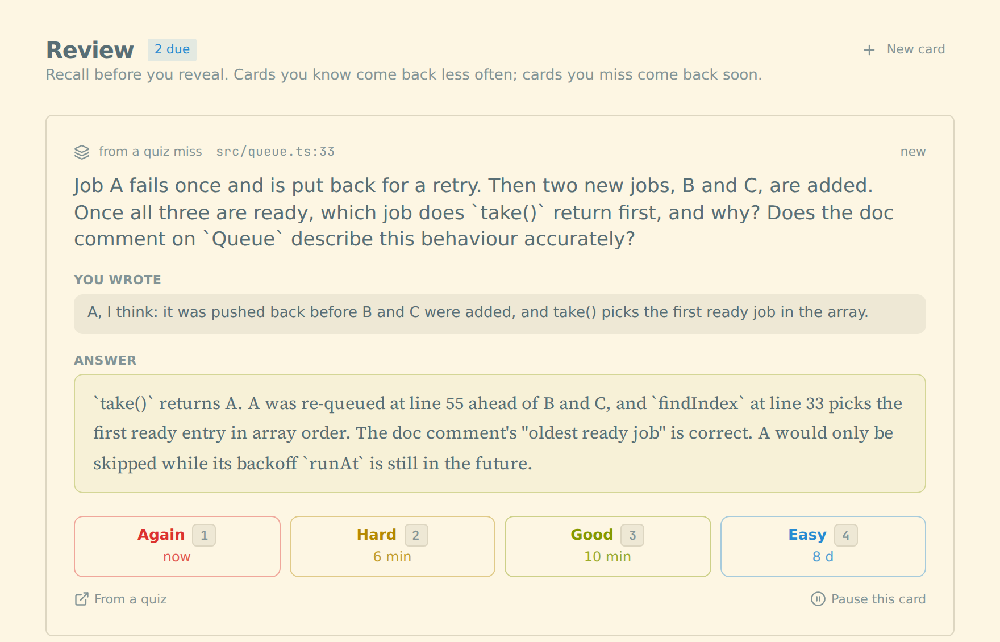

<h1 align="center">cognitune</h1>

<p align="center"><b>Understand any codebase, and prove to yourself that you do.</b></p>

<p align="center">
  <a href="https://www.npmjs.com/package/cognitune"></a>
  
  
  
</p>

<p align="center">
  <picture>
    <source media="(prefers-color-scheme: dark)" srcset="https://raw.githubusercontent.com/k-pulkit/cognitune/main/assets/screenshots/lens-dark.png">
    
  </picture>
</p>

AI makes code faster to write and easier to not understand. cognitune turns the model around: instead of
writing code for you, it helps you build the model of the code in your own head, then checks that you did.

```bash
npx cognitune ./my-repo     # open any folder
npx cognitune --demo        # a sample repo and canned answers: every page in a minute, no model needed
```

It uses the coding CLI you already have (Claude Code, Codex, Copilot) with its own login, reads only the
files you pick, and never writes to your folders. Full setup: [SETUP.md](SETUP.md).

Every screenshot below is real model output on the bundled demo repo, a 100-line retry queue.

---

## Read code with a question

### Lenses

Pick files, pick a question (*Explain*, *Data flow*, *Failure modes*, *Trace a run*, *The change*,
*History*, or your own) and get a lesson: the idea in one sentence, the words you need, an intuition, then a
walkthrough where every step shows its own lines of code, a pitfall and a question to check yourself.

**Ask more.** A lens is not a dead end. Ask a follow-up at the bottom, optionally with extra files, and the
answer is added to the same lens.

<p align="center"></p>

### Tutor

A Socratic chat over your files. It answers with a question or a hint first and gives a little more each
turn; say "just tell me" any time. Every "line 50" or "lines 41-48" in a reply jumps the code pane there.

<p align="center"></p>

### Walkthrough

The file in reading order, not file order, one block at a time. Each block ends with a question you answer
before moving on, graded against the code. Missed one? Try it again in your own words.

<p align="center"></p>

---

## Prove it

### Quizzes

Free-text questions about behaviour and reasons, not names. Mark each answer *sure* or *guess*. The grader
names the line you got wrong and shows a good answer; a confident wrong answer is flagged as the one to
look at first.

<p align="center"></p>

### Changes

Compare two git refs, or HEAD with your working tree, in a syntax-highlighted split diff. Then lens it,
quiz yourself on it, explain it back, or ask the tutor about it: every one of them sees the diff.

<p align="center"></p>

Also: **Teach-back** (explain the code in your own words, graded 1-5 with what you got right, missed and
got wrong), **Practice** (the key logic is cut out of a copy of your file; write it back, with hints) and
**Bug hunt** (realistic bugs planted in a copy; find them and say why).

---

## Keep it

### Today, weak spots and review cards

Each project opens on what to do now. Wrong answers are saved as the belief behind them ("you think X, but
Y"), so the next quiz can aim at exactly those. Quiz misses become spaced-repetition cards (FSRS) that link
back to where they came from.

<table>
  <tr>
    <td width="50%"></td>
    <td width="50%"></td>
  </tr>
  <tr>
    <td width="50%"></td>
    <td width="50%"></td>
  </tr>
  <tr>
    <td align="center"><sub><b>Map</b>: the import graph shows where to start</sub></td>
    <td align="center"><sub><b>Progress</b>: per file, and fading when you stop recalling it</sub></td>
  </tr>
</table>

**Paths** give an ordered tour of a repo, each stop with the activity that fits. The **Library** holds
everything made, plus a glossary built from every lens. `Ctrl/Cmd+K` jumps anywhere; `?` lists shortcuts.

---

## Why it works

It is built on what makes learning stick: **recall beats re-reading**, **spacing beats cramming**, and
**producing an answer before you see one beats reading the answer**. That is why the tutor hints before it
tells, a lens can ask for your own take first, and a missed check asks you to try again rather than
explaining it to you a second time.

<details>
<summary><b>All features</b></summary>

| | |
|---|---|
| **Lenses** | See code through one question: *Explain*, *Data flow*, *State over time*, *Failure modes*, *Contracts*, *Concepts*, *The change*, *Trace a run* (a debugger without running: line by line with the variables), *History* (why it is like this, from git), or your own. Tick **My take first** to write your own guess before the lens; it opens with where you differ. On a diff, that becomes **Predict first**. Ask follow-ups at the end; the answers are added to the same lens. A lens shows a banner when its code changes, with one-click refresh. |
| **Walkthrough** | The file in reading order (not file order), one block at a time, with a check question on each block before the next. Retry a block you missed. |
| **Tutor** | A Socratic chat over the files. It answers with a question or a hint first and gives a bit more each turn; ask it to just tell you any time. Line references jump the code pane. |
| **Map** | The import graph (TS/JS with tsconfig aliases, Python), sized by how many files import each one. |
| **Paths** | An ordered tour of the repo, 6-12 stops, each with the activity that fits. Stops tick off as you do them. |
| **Quizzes** | Free-text questions about behaviour and reasons, not names. Mark each answer *sure* or *guess*. Graded with feedback that names the line and a good answer to compare with. |
| **Teach-back** | Explain the code in your own words. Graded 1-5: what you got right, what you missed, what is wrong. |
| **Practice** | The key logic is cut out of a copy of your file (4 levels). Write it back, with hints, then "check my work". |
| **Bug hunt** | Realistic bugs are planted in a copy of the file. Click the lines you suspect and say why; see found, missed and false alarms. |
| **Changes** | Two git refs, or HEAD vs your working tree. Read the diff, then predict, lens, quiz, teach back or ask the tutor about the change itself. |
| **Review cards** | Spaced repetition (FSRS). Quiz misses become cards on their own; lens concepts and code lines can become cards in one click. |
| **Weak spots** | Wrong answers are saved as the belief behind them. Quiz one weak spot or all of them; a right answer clears one; dismiss one the grader got wrong. |
| **Today** | Due cards, weak spots, files that need a refresh, the next stop on your path, and one suggested 10-minute activity. |
| **Progress** | Per file: *seen*, *understood* (a check passed on the code as it is now), *fading* (no recall for a few weeks), *stale* (the code changed since). Table, or a heatmap of the whole repo. |
| **Library** | Everything made, searchable, plus a glossary and your margin notes. Export a lens or quiz as markdown, or a whole project as JSON. |

Context is what you pick: tick files in the tree, or add extra folders (docs, notes, design files) to a
project as context. The model reads only what you give it. Long jobs keep running if you leave the page;
the status bar says when they are ready.

</details>

<details>
<summary><b>Model access</b>: Claude Code, Codex, Copilot or the Anthropic API</summary>

cognitune makes one model call per lens, quiz, grade, practice, tutor turn and so on (about 15 s to 2 min).
Replies are checked against a schema (one retry with the problems listed), and lens, walkthrough and path
replies are cached: the same lens on an unchanged file is free the second time.
It drives a coding CLI you already use, with that CLI's own login, so **cognitune never asks for or
stores a key**. Pick one in Settings; *Auto* takes the first one it finds, in this order:

| Provider | How cognitune runs it | Login |
|---|---|---|
| **Claude Code** (default) | `claude -p`, read-only tools (`Read`, `Grep`, `Glob`) | your Claude Code login |
| **OpenAI Codex** | `codex exec -`, `--sandbox read-only` | `codex login` |
| **GitHub Copilot** | `copilot -p -s`, only the `read` tool (shell and write denied) | your Copilot login, or `COPILOT_GITHUB_TOKEN` / `GH_TOKEN` |
| **Anthropic API** | Messages API; the picked files go in the prompt | `ANTHROPIC_API_KEY` in the environment |

Each CLI runs with the project folder as its working directory. Model per provider is optional
(empty = the CLI's default). `COGNITUNE_AGENT=fake` gives canned answers, to try the UI without a model.

</details>

<details>
<summary><b>Your files are safe</b>: local only, read-only, bounded storage</summary>

- cognitune never writes to your folders. Practice works on a copy.
- The server binds to `127.0.0.1` only. There is no login: it is a local, one-person tool.
- Everything it makes lives in `~/.cognitune` (change with `COGNITUNE_HOME`), as plain JSON files, one
  per item. Files, not SQLite: the data is small, you can read and back it up, and there is no native
  module to build.

```
~/.cognitune/
  settings.json  projects.json  jobs.json  prune.json
  projects/<id>/<lenses|quizzes|practice|cards|misconceptions|teachbacks|threads|walks|hunts|paths|notes>/<id>.json
  projects/<id>/archive/...        "Archive" moves items here
  archive/projects/<id>/           a project you removed from the list
  cache/<hash>.json                saved model replies
```

**It does not keep growing.** Every part that could grow has a limit (Settings > Storage shows the
sizes and has *Clean up now*):

| What | Limit (setting) |
|---|---|
| Archived items and removed projects | deleted after 30 days (`storage.archiveDays`; reopen a removed folder in time and its history comes back) |
| Model reply cache | 50 MB, least recently used goes first (`storage.cacheMB`) |
| Graded attempts per quiz | newest 20, the best one always kept (`storage.maxAttempts`) |
| Card review history, tutor messages, job history | 50 per card, 200 per chat, 100 jobs |
| Temp files left by a crash | removed after an hour |

Cleanup runs at start-up and every 6 hours, and only ever inside the cognitune folder.

</details>

<details>
<summary><b>CLI and development</b></summary>

```
cognitune [folder] [--port 4711] [--host 127.0.0.1] [--no-open] [--demo]
```

```bash
npm install
npm run dev          # API on :4711 (tsx watch) + Vite on :5173 with hot reload
npm test             # core and API tests (vitest, fake model, temp git repos)
npm run typecheck
npm run build        # dist/web (Vite) + dist/cli.js (tsup)

# Browser smoke test over every page (needs a Chromium; set CHROME or have one in ~/.cache/ms-playwright)
COGNITUNE_HOME=$(mktemp -d) COGNITUNE_AGENT=fake node dist/cli.js . --port 4799 --no-open &
node test/ui-smoke.mjs [--dark] [--shots DIR]
```

Layout:

```
src/cli.ts              CLI: serves the API and the built web app
src/server/app.ts       Hono routes under /api
src/core/               no HTTP here: workspace (files, git), graph (imports), store, storage (limits, cache),
                        prompts, schemas, services (model work), insights (cards, progress, today), jobs, agent adapters
demo/sample/            the small repo --demo opens
web/src/                React + Vite + Tailwind: pages/, components/, lib/
```

Stack: TypeScript everywhere. Hono on Node 20+, zod, ts-fsrs. React 18, React Router, TanStack Query,
Tailwind, Shiki (code), CodeMirror (practice editor), Mermaid (diagrams), d3-force (map).

</details>

## License

MIT
