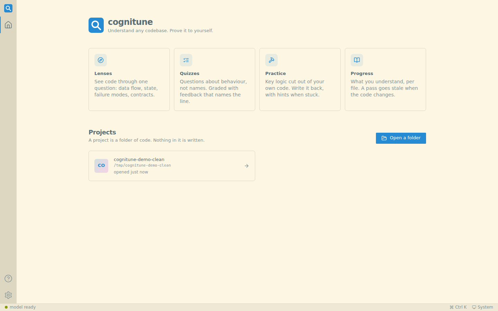
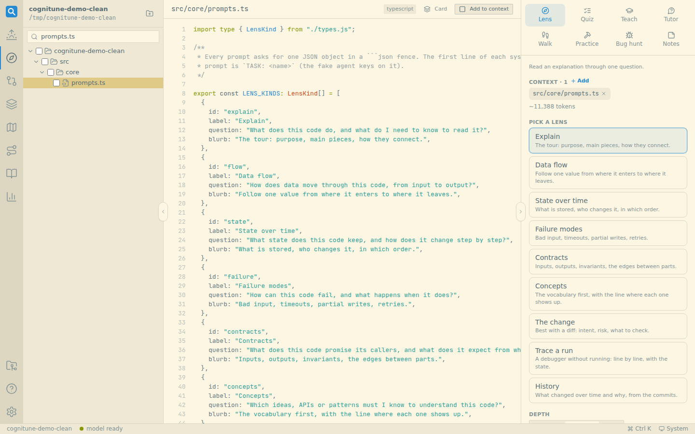
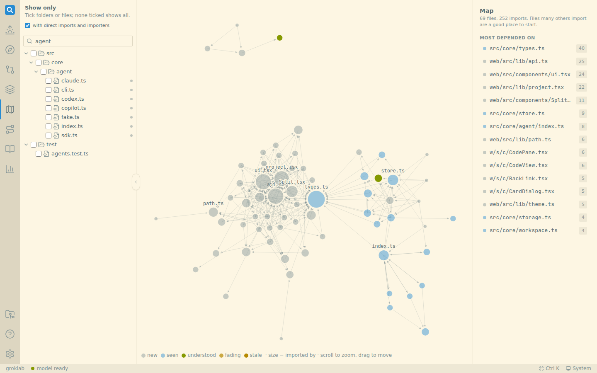
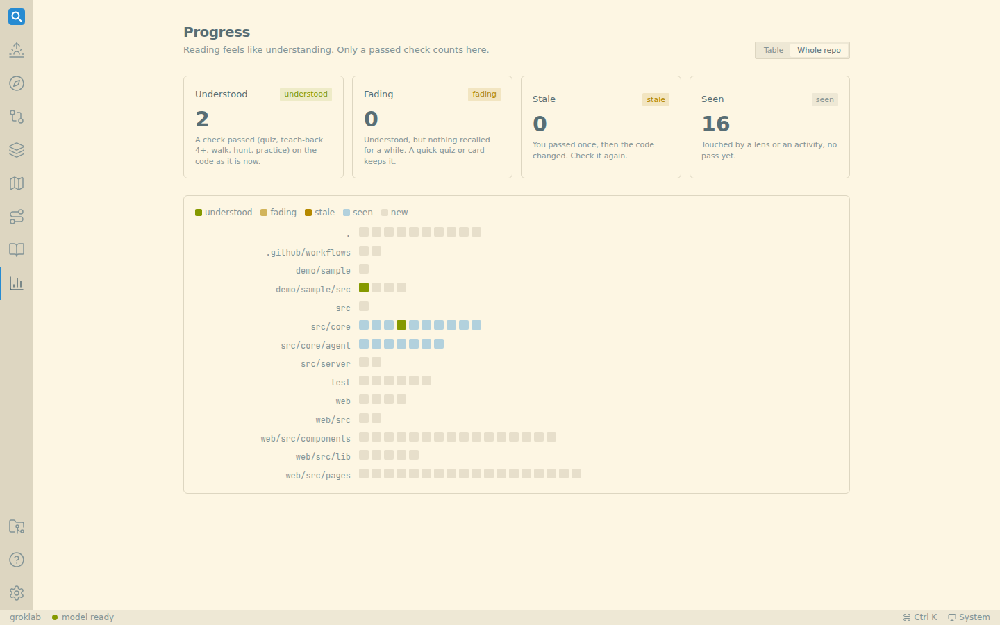

# cognitune

Understand any codebase, and prove to yourself that you do.

AI makes code faster to write and easier to not understand. cognitune turns the model around: instead of
writing code for you, it helps you build the model of the code in your own head.

```bash
npx cognitune ./my-repo
npx cognitune --demo        # a sample repo and canned answers: see every page in a minute, no model needed
```

| | |
|---|---|
|  |  |
|  |  |

## What it does

It is built on what makes learning stick: recall beats re-reading, spacing beats cramming, and
producing an answer before you see one beats reading the answer.

**Read, with a question**

| | |
|---|---|
| **Lenses** | See code through one question: *Explain*, *Data flow*, *State over time*, *Failure modes*, *Contracts*, *Concepts*, *The change*, *Trace a run* (a debugger without running: line by line with the variables), *History* (why it is like this, from git), or your own. Tick **My take first** to write your own guess before the lens; it opens with where you differ. On a diff, that becomes **Predict first**. A lens shows a banner when its code changes, with one-click refresh. |
| **Walkthrough** | The file in reading order (not file order), one block at a time, with a check question on each block before the next. |
| **Tutor** | A Socratic chat over the files. It answers with a question or a hint first and gives a bit more each turn; ask it to just tell you any time. Opens from any missed quiz question too. |
| **Map** | The import graph (TS/JS with tsconfig aliases, Python), sized by how many files import each one: where to start. |
| **Paths** | An ordered tour of the repo, 6-12 stops, each with the activity that fits. Stops tick off as you do them. |

**Prove it**

| | |
|---|---|
| **Quizzes** | Free-text questions about behaviour and reasons, not names. Mark each answer *sure* or *guess*. Graded with feedback that names the line and a good answer to compare with. |
| **Teach-back** | Explain the code in your own words. Graded 1-5: what you got right, what you missed, what is wrong. |
| **Practice** | The key logic is cut out of a copy of your file (4 levels). Write it back, with hints, then "check my work". |
| **Bug hunt** | Realistic bugs are planted in a copy of the file. Click the lines you suspect and say why; see found, missed and false alarms. |
| **Changes** | Two git refs, or HEAD vs your working tree. Read the diff, then predict, lens or quiz the change itself. |

**Keep it**

| | |
|---|---|
| **Review cards** | Spaced repetition (FSRS). Quiz misses become cards on their own; lens concepts and code lines can become cards in one click. |
| **Weak spots** | Wrong answers are saved as the belief behind them ("you think X, but Y"). *Quiz my weak spots* asks new questions aimed at exactly those; a right answer clears one. |
| **Today** | Each project opens on what to do now: due cards, weak spots, files that need a refresh, the next stop on your path, and one suggested 10-minute activity. |
| **Progress** | Per file: *seen*, *understood* (a check passed on the code as it is now), *fading* (no recall for a few weeks), *stale* (the code changed since). Table, or a heatmap of the whole repo. |
| **Library** | Everything made, searchable, plus a glossary built from every lens and your margin notes. Export a lens or quiz as markdown, or a whole project as JSON. |

`Ctrl/Cmd+K` jumps to any page, file or project, or starts an activity. `?` lists all shortcuts.

Context is what you pick: tick files in the tree, or add extra folders (docs, notes, design files) to a
project as context. The model reads only what you give it.

## Model access

cognitune makes one model call per lens, quiz, grade, practice, tutor turn and so on (about 15 s to 2 min).
Replies are checked against a schema (one retry with the problems listed), and lens, walkthrough and path
replies are cached: the same lens on an unchanged file is free the second time.
It drives a coding CLI you already use, with that CLI's own login, so **cognitune never asks for or
stores a key**. Pick one in Settings; *Auto* takes the first one it finds, in this order:

| Provider | How cognitune runs it | Login |
|---|---|---|
| **Claude Code** (default) | `claude -p`, read-only tools (`Read`, `Grep`, `Glob`) | your Claude Code login |
| **OpenAI Codex** | `codex exec -`, `--sandbox read-only` | `codex login` |
| **GitHub Copilot** | `copilot -p -s`, only the `read` tool (shell and write denied) | your Copilot login, or `COPILOT_GITHUB_TOKEN` / `GH_TOKEN` |
| **Anthropic API** | Messages API; the picked files go in the prompt | `ANTHROPIC_API_KEY` in the environment |

Each CLI runs with the project folder as its working directory. Model per provider is optional
(empty = the CLI's default). `COGNITUNE_AGENT=fake` gives canned answers, to try the UI without a model.

## Your files are safe

- cognitune never writes to your folders. Practice works on a copy.
- Everything it makes lives in `~/.cognitune` (change with `COGNITUNE_HOME`), as plain JSON files, one
  per item. Files, not SQLite: the data is small, you can read and back it up, and there is no native
  module to build.

```
~/.cognitune/
  settings.json  projects.json  jobs.json  prune.json
  projects/<id>/<lenses|quizzes|practice|cards|misconceptions|teachbacks|threads|walks|hunts|paths|notes>/<id>.json
  projects/<id>/archive/...        "Archive" moves items here
  archive/projects/<id>/           a project you removed from the list
  cache/<hash>.json                saved model replies
```

**It does not keep growing.** Every part that could grow has a limit (Settings > Storage shows the
sizes and has *Clean up now*):

| What | Limit (setting) |
|---|---|
| Archived items and removed projects | deleted after 30 days (`storage.archiveDays`; reopen a removed folder in time and its history comes back) |
| Model reply cache | 50 MB, least recently used goes first (`storage.cacheMB`) |
| Graded attempts per quiz | newest 20, the best one always kept (`storage.maxAttempts`) |
| Card review history, tutor messages, job history | 50 per card, 200 per chat, 100 jobs |
| Temp files left by a crash | removed after an hour |

Cleanup runs at start-up and every 6 hours, and only ever inside the cognitune folder.

- The server binds to `127.0.0.1` only. There is no login: it is a local, one-person tool.

## CLI

```
cognitune [folder] [--port 4711] [--host 127.0.0.1] [--no-open] [--demo]
```

## Develop

```bash
npm install
npm run dev          # API on :4711 (tsx watch) + Vite on :5173 with hot reload
npm test             # core and API tests (vitest, fake model, temp git repos)
npm run typecheck
npm run build        # dist/web (Vite) + dist/cli.js (tsup)

# Browser smoke test over every page (needs a Chromium; set CHROME or have one in ~/.cache/ms-playwright)
COGNITUNE_HOME=$(mktemp -d) COGNITUNE_AGENT=fake node dist/cli.js . --port 4799 --no-open &
node test/ui-smoke.mjs [--dark] [--shots DIR]
```

Layout:

```
src/cli.ts              CLI: serves the API and the built web app
src/server/app.ts       Hono routes under /api
src/core/               no HTTP here: workspace (files, git), graph (imports), store, storage (limits, cache),
                        prompts, schemas, services (model work), insights (cards, progress, today), jobs, agent adapters
demo/sample/            the small repo --demo opens
web/src/                React + Vite + Tailwind: pages/, components/, lib/
```

Stack: TypeScript everywhere. Hono on Node 20+, zod, ts-fsrs. React 18, React Router, TanStack Query,
Tailwind, Shiki (code), CodeMirror (practice editor), Mermaid (diagrams), d3-force (map).

## License

MIT
