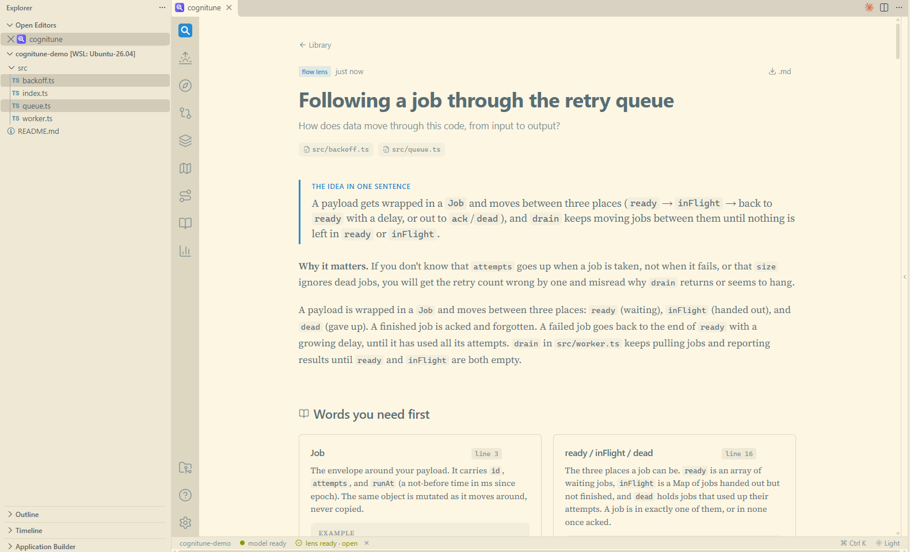
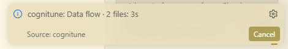
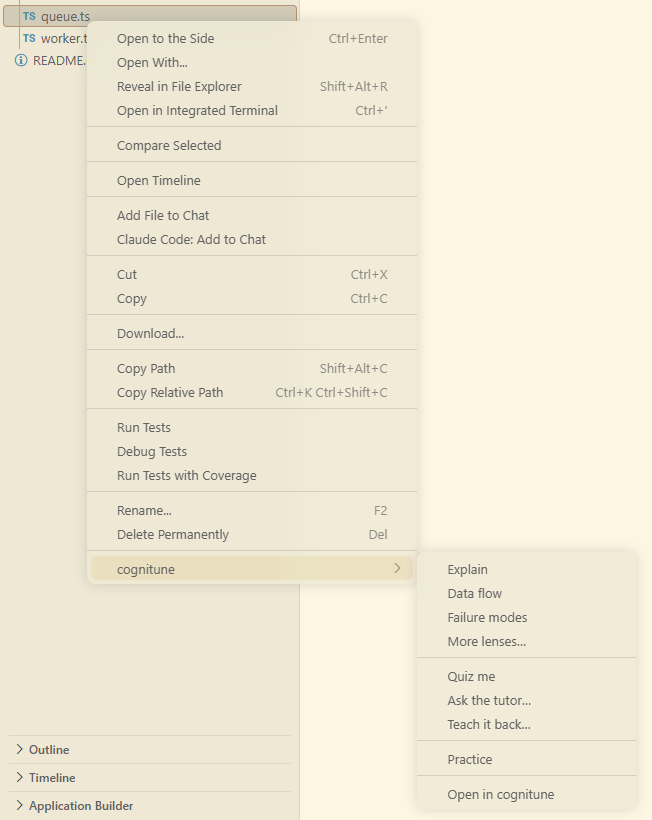
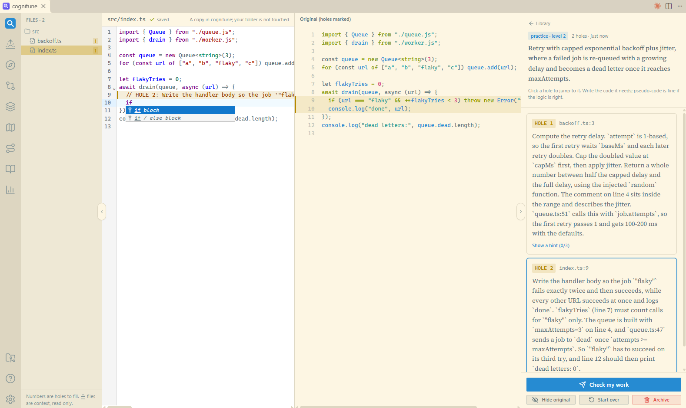

# cognitune for VS Code

**Right-click code you (or an AI) just wrote, and make sure you actually understand it.**
Explain it, get quizzed on it, ask a tutor that gives hints instead of answers, and keep it with
spaced review. Everything opens in a panel beside your editor; your code is never changed.

## Get started

1. Have a model CLI you already use: **Claude Code** (`claude`), **Codex** (`codex`) or **GitHub
   Copilot CLI** (`copilot`), logged in. Or set `ANTHROPIC_API_KEY`. cognitune never asks for a key.
2. Right-click a file or folder in the Explorer, or inside the editor, and open **cognitune**.
3. Pick **Explain**. A notification shows progress; the lens opens in a panel beside the code.

   

4. Then **Quiz me** to check you got it. Missed questions come back later as review cards.

## Right-click: cognitune

Works on one file, several selected files (Ctrl/Cmd+click), a folder (its files, minus
`node_modules`, build output and your `files.exclude`), or the file in the editor.

| Item | What you get |
|---|---|
| **Explain** | The tour: purpose, main pieces, how they connect. |
| **Data flow** | One value followed from where it enters to where it leaves. |
| **Failure modes** | Bad input, timeouts, partial writes, retries. |
| **More lenses…** | State over time, contracts, concepts, trace a run, history, or **your own question**. |
| **Quiz me** | Questions on the selected code; answers are graded and misses become review cards. |
| **Ask the tutor…** | Type what you want to understand; it answers with hints, one step at a time. |
| **Teach it back…** | Explain the code in your own words; it marks what you got right and what you missed. |
| **Walk me through** | One file, block by block, with a check after each block. |
| **Bug hunt** | A copy of the file with a planted bug for you to find. |
| **Practice** | Write a piece of it back yourself. |
| **Open in cognitune** | The files in the full app, to choose for yourself. |

In the panel, **open in editor** on any file jumps to it here at that line.

**Practice**: the key lines are cut out of a copy for you to write back, with hints. Your folder is not touched.

## Everywhere else in VS Code

- **Activity bar → cognitune**: one-click rows for *Today*, *Explain this file*, *Quiz me on this
  file*, *Quiz me on uncommitted changes* and *Review cards*. The **…** menu has *Restart server*
  and *Stop server*.
- **Source Control title bar**: *Quiz me on uncommitted changes* opens the diff of your working tree,
  ready for a lens or a quiz on the change itself.
- **Editor title bar**: the cognitune button opens the current file in cognitune at your cursor line.
- **Status bar**:
  - `⊘ cognitune`: off. Click to start it.
  - spinning `cognitune`: starting.
  - `cognitune · Lens 23s`: a job running, with a timer.
  - `🎓 cognitune · 2 due`: ready, with review cards due. Click to review.

## Commands

All under **cognitune:** in the Command Palette (Ctrl/Cmd+Shift+P).

| Command | Does |
|---|---|
| Open | Today for this folder: what is due, what changed, where to go next. |
| Explain / Data flow / Failure modes / More lenses… / Quiz me / Ask the tutor… / Teach it back… / Walk me through / Bug hunt / Practice | The same as the right-click items, on the current file. |
| Quiz me on uncommitted changes | Changes page for the repo. |
| Review due cards | Today's review cards. |
| Restart server / Stop server | Control the server this window started. |
| Show log | The server's output. |

## Settings

| Setting | Default | |
|---|---|---|
| `cognitune.port` | `4711` | Port of the cognitune server. A server already running there (for example from `npx cognitune`) is reused; otherwise the extension starts the one bundled inside it. |

## How it runs

The extension carries the cognitune server and starts it with VS Code's own Node, so there is
nothing else to install. It listens on `127.0.0.1` only. When VS Code is connected to WSL, SSH or a
container, the server runs on that side, next to your code, and the panel reaches it through VS
Code's port forwarding.

Your notes, scores and review cards are plain JSON files in `~/.cognitune` on that machine. The
model reads only the files you pick; cognitune never writes to your folders, and its model calls
do not show up in your own `claude --resume` list.

The same app also runs without VS Code: `npx cognitune ./your-repo` opens it in a browser, with the
same data.

## Tested on

Built and tested on **Windows with VS Code connected to WSL (Ubuntu)**. macOS, a Linux desktop, and
VS Code over SSH or in a container should work the same way, but have not been tried yet. Please
[open an issue](https://github.com/k-pulkit/cognitune/issues) if something is off.

## More

[Project README](https://github.com/k-pulkit/cognitune#readme) · [Changelog](https://github.com/k-pulkit/cognitune/blob/main/CHANGELOG.md) · MIT license
